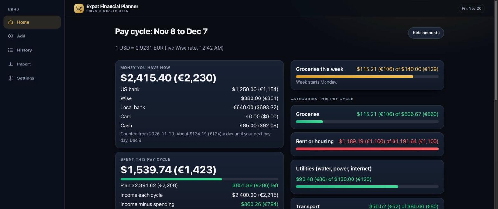
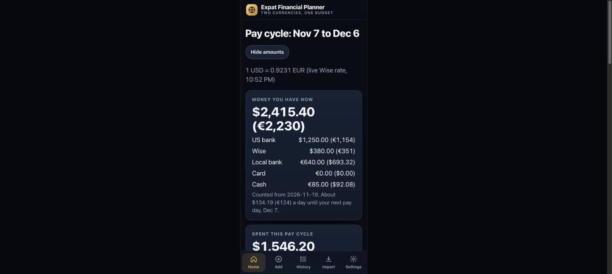
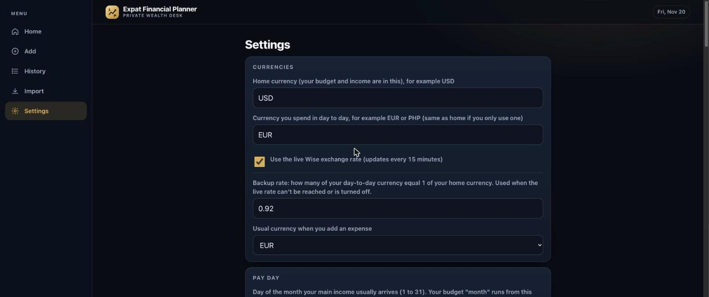

# Expat Financial Planner

**A free, private budget planner for people who earn in one currency and live in another.**

You get paid in dollars, pounds or euros, and you pay rent and buy groceries in pesos, baht, euros or something else. Most budget apps only handle one currency, so you end up doing the sums in your head. Expat Financial Planner shows every amount in both currencies at the live exchange rate. It runs on your own Google Sheet, so your money data stays in your own Google account.

It also uses **AI**: Claude can read your bank statements, sort each transaction into the right category, and write you a short plain-English check-in on how your pay cycle is going.



*Screenshots use made-up sample data.*

## What it does

- **Two currencies everywhere.** Every amount shows your home currency with your local currency beside it, for example `$120.00 (€111)`. It uses the live rate from Wise, updated every 15 minutes, or a backup rate you type in.
- **Money you have now.** Type what's in each account once (bank, Wise, local bank, e-wallet, cash). Each account can be in its own currency. After that, every expense and transfer you add is taken off automatically, so Home always shows what you have left and how much you can spend per day until your next pay day.
- **Budgets that follow your pay day.** Your budget "month" runs from the day your income arrives, not from the 1st. Each budget can be in either currency, so rent can be set in local money and stay exact whatever the exchange rate does.
- **Warnings before you overspend.** You get alerts at 50%, 75% and 100% of each budget, plus a warning if your day-to-day spending pace is ahead of plan.
- **Upload bank statements.** Drop in a CSV or PDF statement and the transactions are added for you. Duplicates are skipped. There is a dedicated reader for **Wise** PDF statements: it handles card holds that get released, refunds, fees and currency conversions.
- **Claude checks your categories.** After an upload, Claude reviews each transaction and fixes the wrong ones. For example, it moves a ride-hailing trip from "Other" to "Transport", or changes money you moved between your own accounts from "spending" to a "transfer".
- **AI money check-in.** One button asks Claude for a short, simple summary: how the cycle is going, what to watch, and a safe daily amount until pay day.
- **Easy to use.** Large text, a text-size control, light and dark colours, a "read summary out loud" button and a button to hide all amounts. It works on a phone or a computer.

| Phone | Add an expense | Settings |
|---|---|---|
|  |  |  |

## Set it up (about 10 minutes)

You need a Google account. A Claude API key is optional, and you only need one for the AI features.

1. **Make a new Google Sheet.** Go to [sheets.new](https://sheets.new) and give it a name, for example "My Expat Budget".
2. **Open the script editor.** In the sheet's menu, choose **Extensions → Apps Script**.
3. **Add the server code.** Delete everything in `Code.gs`, then paste in the contents of [`Code.gs`](Code.gs) from this repository.
4. **Add the page.** Click the **+** next to "Files", choose **HTML**, and name it `Index` (exactly that). Delete what's inside, then paste in the contents of [`Index.html`](Index.html).
5. **Save.** Press Ctrl+S (Cmd+S on a Mac).
6. **Publish it as your own private web app.** Click **Deploy → New deployment**. Click the gear icon and choose **Web app**. Set "Execute as" to **Me** and "Who has access" to **Only myself**. Click **Deploy**. When Google asks, allow access. It may show a warning screen. If it does, click **Advanced**, then **Go to (your project)**. This is normal for scripts you make yourself.
7. **Open the link** Google gives you. Bookmark it, or add it to your phone's home screen.
8. **Fill in Settings** the first time. Enter your home and local currency, your pay day, your income, your accounts and your budgets. Then open **Money you have now** and type what's in each account today.

### Optional: turn on the AI features

1. Get a Claude API key from [console.anthropic.com](https://console.anthropic.com). It starts with `sk-ant-`. Claude API use is billed by Anthropic, and checking a month of transactions usually costs a few cents.
2. In the app, open **Settings → Claude AI review**. Paste the key yourself and press **Save key**.

The key is stored in your script's private "Script Properties". It is never put in the sheet or in the code, so it is not copied if you share the sheet. You can remove it at any time in Settings.

## Privacy

- Your transactions and settings live in **your own Google Sheet**. The app is deployed from **your own Google account**. There is no server run by anyone else, no tracking, and no ads.
- When you use the AI features, the transactions being checked, or a summary of your pay cycle, are sent to Anthropic's Claude API using **your** key. Nothing is sent to the author of this project.
- To get the exchange rate, the script asks Wise's public rate page for the current rate. Only the two currency codes are sent.
- With "Who has access: Only myself", only you can open the app. If you share it with a partner, they can add expenses too, and each entry records who added it.

## About the exchange rate

The live rate comes from Wise's public rate page (`wise.com/rates/live`). This is **not an official, supported API**, so Wise could change or remove it at any time. If it can't be reached, or you switch the live rate off in Settings, the app uses the backup rate you typed in. The rate is for planning only. The rate your bank or card actually charges may differ.

## Changing the code

The app's code is in [`src/app.js`](src/app.js) and the page layout is in [`src/index.template.html`](src/index.template.html). Google Apps Script can damage some modern JavaScript, so the code is stored inside `Index.html` in an encoded form. After editing, rebuild it with:

```
python3 build.py
```

Then paste the new `Index.html` into your script and make a new version under **Deploy → Manage deployments**.

## Disclaimer

This is a personal budgeting tool, not financial advice. Check important numbers against your bank.

## License

MIT. See [LICENSE](LICENSE).
